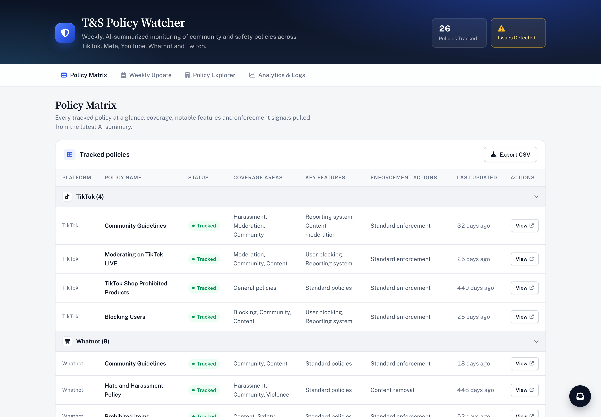

# T&S Policy Watcher

Automated competitive intelligence for Trust & Safety teams. The watcher checks 26 community, safety and moderation policy pages across **TikTok, Meta, YouTube, Whatnot and Twitch** every week, detects substantive changes, has an LLM (Cloudflare Workers AI, with Gemini as fallback) summarize what changed and why it matters, and publishes everything to a live dashboard.

**Live dashboard:** https://ts-policy-watcher.vercel.app



## Why it exists

Platform policies change quietly: a new enforcement note, a removed link, a reworded prohibition. For a marketplace or live-commerce product, those shifts are early signals of where competitors are taking safety, trust and seller rules. Checking dozens of pages by hand is slow and easy to miss. This project turns that into a weekly, reviewable feed.

## What you get

| View | What it shows |
|---|---|
| **Policy Matrix** | Every tracked policy with coverage areas, key features, enforcement signals and freshness. Exports to CSV. |
| **Weekly Update** | An AI-written executive summary of the week's changes, with a picker for every past week. |
| **Policy Explorer** | AI summaries per platform, the latest change for each policy, and a version history of cleaned snapshots. |
| **Analytics & Logs** | Change velocity over time, per-platform activity, and the pipeline's own run log and success rate. |

## How it works

```
GitHub Actions (Fridays 15:00 UTC)
  │
  ├─ scripts/health_check.py     pre-flight URL checks (catches 403s, redirects, bot walls)
  ├─ scripts/fetch.py            Playwright/httpx fetch → cleaned HTML snapshots in snapshots/
  ├─ scripts/diff_and_notify.py  git diff of snapshots → Workers AI / Gemini summaries → summaries.json, run_log.json
  └─ scripts/weekly_aggregator.py  weekly roll-up → weekly_summaries.json
                    │
                    ▼
  dashboard/ (static HTML/CSS/JS on Vercel) reads the JSON straight from GitHub
```

Design choices worth noting:

- **Git is the database.** Every snapshot is a commit, so history, diffs and rollbacks come for free and the dashboard needs no backend.
- **Noise filtering before AI.** Pages are reduced to their main content and stripped of dynamic IDs, feedback forms, hidden elements, search and navigation chrome before diffing, so cosmetic churn doesn't trigger a summary.
- **Failure is visible.** Health checks, retries and a run log surface partial failures (for example a platform starting to block automated fetches) directly in the dashboard header.

## Run it locally

```bash
git clone https://github.com/lyori6/ts-policy-watcher.git
cd ts-policy-watcher

# Dashboard (reads live data from GitHub)
npm run dev
# open http://localhost:3000/?dataBranch=main
```

To run the pipeline yourself:

```bash
python3 -m venv .venv && source .venv/bin/activate
pip install -r requirements.txt
playwright install chromium

export CLOUDFLARE_ACCOUNT_ID=... # summaries (Workers AI)
export CLOUDFLARE_API_TOKEN=...
export GEMINI_API_KEY=...        # fallback
export RESEND_API_KEY=...        # optional email digests
export RECIPIENT_EMAIL=...

python scripts/health_check.py
python scripts/fetch.py
python scripts/diff_and_notify.py
python scripts/weekly_aggregator.py --manual
```

The dashboard's subscribe widget posts to a Vercel function ([`dashboard/api/subscribe.js`](dashboard/api/subscribe.js)) that emails the owner through Resend. Set `RESEND_API_KEY` and `RECIPIENT_EMAIL` in the Vercel project for it to work.

The monitored pages live in [`platform_urls.json`](platform_urls.json); add an entry to start tracking a new policy.

## Tests

```bash
npm install
npx playwright install chromium
npm test
```

Visual-regression baselines were reset with the 2026 redesign; regenerate them with `npm run test:update-snapshots`.

## Project layout

```
dashboard/          static dashboard (index.html, style.css, script.js)
scripts/            fetch, diff, summarize, health-check and weekly aggregation
snapshots/          cleaned policy snapshots and per-policy history (written by CI)
.github/workflows/  weekly watch + weekly summary jobs
docs/               product brief, architecture decisions, technical handoff
tests/              Playwright and pytest suites
```

More detail: [docs/INDEX.md](docs/INDEX.md).

## Tech

Python · Playwright · BeautifulSoup · Cloudflare Workers AI · Google Gemini · Resend · GitHub Actions · vanilla JS dashboard on Vercel

---

Built by [Lyor Itzhaki](https://github.com/lyori6).
